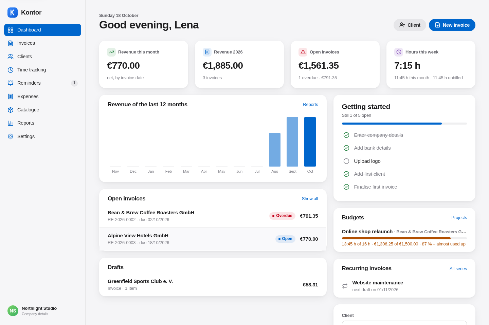
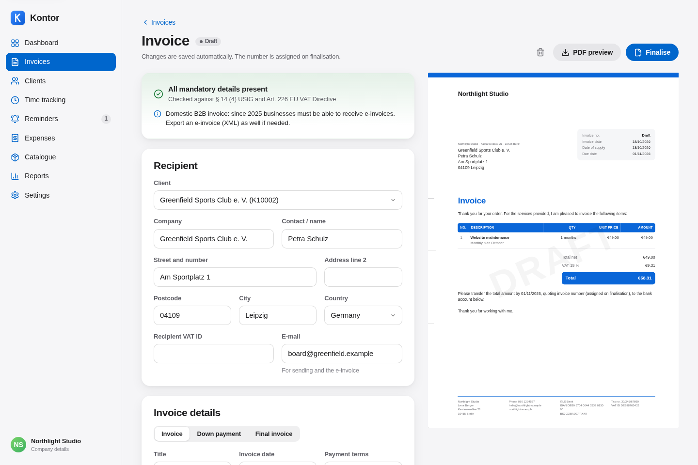
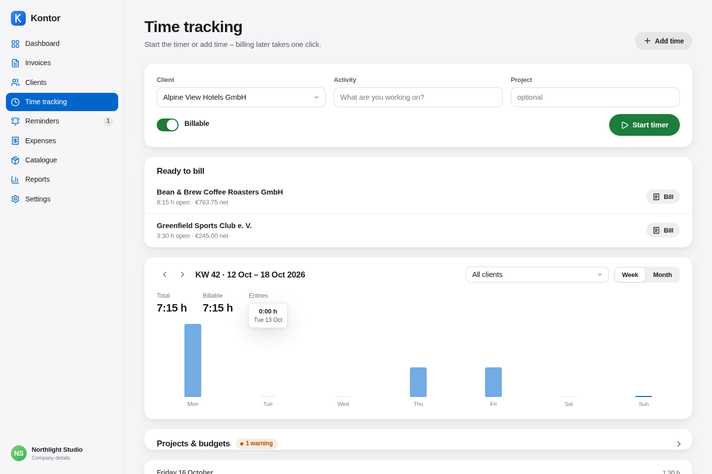
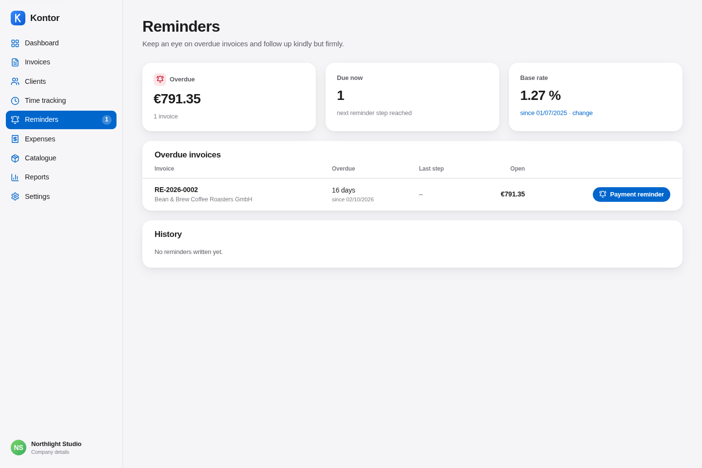
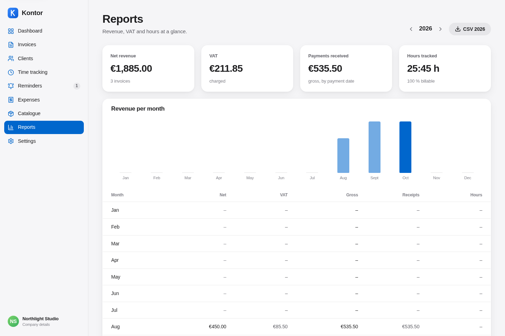
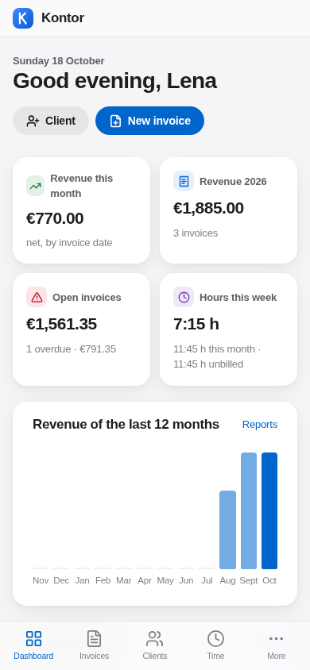
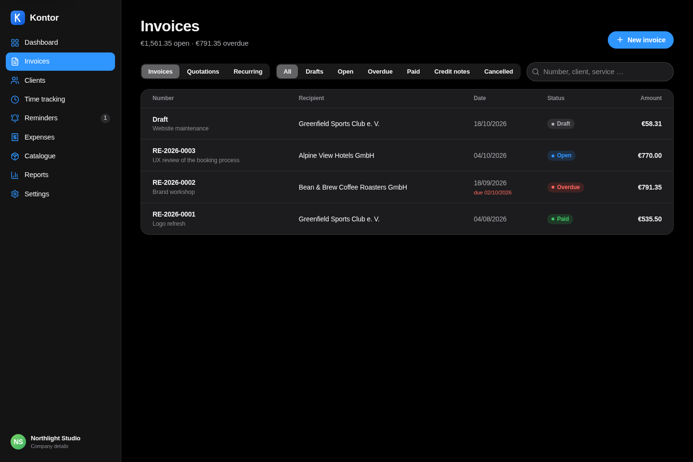

# Kontor

Invoicing and time tracking for freelancers and small businesses in Germany and the EU. Track time per client, turn it into an invoice with one click, let Kontor check the mandatory details, then send the invoice as PDF or e-invoice (ZUGFeRD / XRechnung) and follow up with payment reminders.

Kontor runs as a small self-hosted server. All data lives in the server's SQLite database; the browser keeps nothing but the session cookie and the interface language. The interface is English by default and available in German.



| Invoice editor | Time tracking |
| --- | --- |
|  |  |

| Reminders | Reports |
| --- | --- |
|  |  |

| Mobile | Dark mode |
| --- | --- |
|  |  |

## Features

**Invoices and documents**
- Invoices for clients or as quick invoices to any recipient, quotations that convert into invoices
- Items with quantity, unit, price, VAT rate and item discount; a discount on the whole invoice (percentage or amount) that is split across the VAT rates and exported as allowance per rate
- Down payment invoices and final invoices that deduct them, with net and VAT per rate (§ 14 (5) UStG)
- Credit notes (*Rechnungskorrektur*) with their own number range, full or partial, referencing the original invoice – in addition to cancellation invoices (*Stornorechnung*)
- Partial payments with remaining amount; the invoice is settled by payments and credit notes
- Gap-free, sequential numbers per range (e.g. `RE-{YYYY}-{0001}`), assigned by the server at finalisation, even with several people working at the same time
- Finalised documents are immutable on the server (GoBD idea); payments, credit notes and other changes are written to an audit log
- Recurring invoices: interval, next run, the server creates the draft on the due date; placeholders `{Monat}`, `{Jahr}`, `{Quartal}`, `{Zeitraum}`
- Service catalogue with search in the editor
- Documents in the client's language (English or German), currencies EUR, CHF, USD and GBP
- Three PDF layouts in A4 / DIN 5008 with fold marks, live preview

**Compliance**
- Continuous check of the mandatory details (§ 14 (4) UStG, Art. 226 EU VAT Directive), including small business (§ 19 UStG), reverse charge, intra-Community supply, third country and small invoices (§ 33 UStDV)
- E-invoices: ZUGFeRD / Factur-X PDF (profile EN 16931) as **PDF/A-3B** with embedded fonts, sRGB output intent and XMP metadata, or XRechnung 3.0 as CII XML
- Import of incoming XRechnung / ZUGFeRD (CII or UBL, also embedded in a PDF) as expense

**Getting paid**
- Payment reminder, first and final reminder as separate documents with PDF, configurable intervals, fees and texts
- Default interest per § 288 BGB: base rate (entered in the settings) plus 9 points for businesses or 5 for consumers, optional € 40 flat-rate compensation for businesses
- Overview of overdue invoices with the next step, history per invoice
- Sending by e-mail through your SMTP server with PDF, ZUGFeRD or XRechnung attachment and templates per language; without SMTP Kontor opens your mail program and downloads the file

**Time, projects, expenses, reports**
- Timer per user and manual entries, billing per entry, day or project, configurable rounding (e.g. 15 minutes)
- Projects per client with hour and money budget, progress bars and warnings from 80 %
- Expenses with input VAT, category and receipt file (image or PDF, stored on the server), CSV export
- Revenue, VAT overview by invoice date (*Soll*) or payment date (*Ist*), simplified profit statement (*EÜR*) and figures for the VAT return (*USt-Voranmeldung*, boxes 81, 86, 21, 41, 45, 66, 83) – as orientation, not tax advice

**Everyday use**
- Quick search with `Cmd/Ctrl + K` over clients, documents and actions; `g` followed by a letter jumps between sections
- Undo for deletions, light and dark mode, responsive down to phone size, installable as an app
- Owner account plus team members in the same workspace
- Automatic database backups on the server, full JSON backup and restore in the interface, CSV export of invoices

## Getting started

Requirements: Node.js 22.13 or newer (Node 24 recommended).

```bash
npm install
cp .env.example .env     # optional, see Configuration
npm run dev              # web app on http://localhost:5173, API on port 8787
```

If port 8787 is taken, start with `API_PORT=8790 npm run dev`. Open the web app and create the owner account. The first account becomes the owner of the workspace; further people are added under *Settings → Account & team*.

Other scripts:

```bash
npm test                 # unit tests (Vitest) and server tests (node:test)
npm run test:e2e         # end-to-end tests with Playwright (needs `npm run build` first)
npm run lint             # oxlint
npm run build            # web app to dist/, server bundle to dist-server/
npm start                # production server: API and web app on one port
```

## Running with Docker

One image serves the API and the web app:

```bash
cp .env.example .env     # set KONTOR_SECRET at least
docker compose up -d     # http://localhost:8787
```

Data, receipts and automatic backups live in the volume `kontor-data` (`/data` in the container). Put a reverse proxy with HTTPS in front of it for anything beyond your own machine; session cookies are marked `Secure` in production.

## Configuration

All settings are environment variables, see [`.env.example`](.env.example):

| Variable | Default | Meaning |
| --- | --- | --- |
| `PORT` | `8787` | Port of API and web app |
| `DATA_DIR` | `./data` | SQLite database and backups |
| `KONTOR_SECRET` | – | Key for encrypting stored SMTP passwords |
| `ALLOW_SIGNUP` | `first` | `first`: only the owner may register, `true`: open, `false`: closed |
| `COOKIE_SECURE` | `true` in production | Secure flag of the session cookie |
| `SESSION_DAYS` | `30` | Session lifetime |
| `BACKUP_INTERVAL_HOURS` | `24` | Automatic backups, `0` disables them |
| `BACKUP_KEEP_DAYS` | `14` | Retention of automatic backups |
| `SMTP_*` | – | Optional server-wide SMTP account |

Secrets never belong in the repository; keep them in `.env`, which is ignored by git.

## Coming from the browser-only version

Earlier versions stored everything in the browser (IndexedDB). After signing in, *Settings → Data & backup* offers to import that data once to the server. A JSON backup from the old version can also be restored there.

## Architecture

- **Web app:** Vite, React 19, TypeScript, own CSS, Lucide icons. It talks only to the API; collections are loaded on demand and kept in memory, changes from other devices arrive via server-sent events.
- **Server:** Express 5 on Node, SQLite through `node:sqlite` with versioned migrations. Domain operations such as finalising, cancelling, crediting, payments or billing time run on the server in one transaction each and are serialised, which keeps numbering gap-free.
- **Shared domain code:** `src/lib` (calculation, numbering, validation, dunning, VAT, e-invoice) runs unchanged in the browser, on the server and in tests on top of a small document store with three backends (API, SQLite, memory).
- **Security:** passwords hashed with bcrypt, HttpOnly session cookies with SameSite, CSRF double-submit token plus origin check, rate limits on login, SMTP passwords encrypted with AES-256-GCM, logs contain only method, path and status.
- **PDF:** pdf-lib in the browser; fonts (Liberation, SIL OFL) and an sRGB profile are bundled for PDF/A.

```
src/lib/        domain logic, store, API client, i18n
src/pages/      pages     src/components/  UI building blocks
server/src/     API, SQLite store, auth, backups, mail
server/test/    server tests      e2e/  Playwright tests
```

Amounts are stored as whole cents and rounded commercially with BigInt.

## E-invoices and validation

The CII data follows EN 16931. Invoices with invoice discount, down payments and final invoices, credit notes, cancellations, reverse charge, small business, third country and CHF were checked with the [KoSIT validator](https://github.com/itplr-kosit/validator) (configuration XRechnung 3.0.2) without errors or warnings. The ZUGFeRD PDFs, reminders and multi-page documents pass [veraPDF](https://verapdf.org) as PDF/A-3B; CI runs veraPDF on every push. There is no official certification, so check new constellations with your recipient's validator before relying on them.

## Data and retention

Invoices generally have to be kept for eight years in Germany. The server writes daily copies of its database to `DATA_DIR/backups`; keep a copy of that folder or of the JSON backup somewhere else as well.

## Deliberately open

- No offline editing: the app shell can be installed, but data and number assignment need the server.
- `node:sqlite` is used instead of a native driver to keep the image simple; it is marked experimental in Node 22 and stable enough in Node 24.
- PDFs are rendered in the browser; the server sends what the client uploads.
- XRechnung is exported in CII syntax only, not UBL.
- No VIES check of VAT IDs, no bank import, no DATEV export.
- The base interest rate (*Basiszinssatz*) is entered manually.
- Reports sum amounts without currency conversion.
- Kontor is not certified GoBD software; immutability and audit log are enforced by the server but not tamper-proof against direct database access.

## Legal note

Kontor helps to write formally complete invoices but is no substitute for tax or legal advice. All checks and texts are provided to the best of our knowledge, without any guarantee. Whether a tax treatment such as reverse charge or the small business scheme applies to you is best clarified with your tax adviser.

## Licence

MIT. The bundled Liberation fonts are licensed under the SIL Open Font License 1.1 (`public/fonts/LICENSE-Liberation.txt`).
